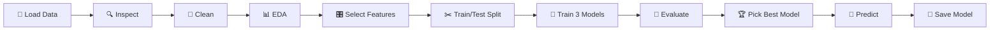

<div align="center">


<p>
  
  
  
  
  
  
</p>

**An end-to-end regression project: from raw advertising data to a saved, reusable prediction model.**

*CodeAlpha Data Science Internship · Task 4*

[Overview](#-project-overview) · [Results](#-results) · [Models](#-machine-learning-models) · [Quick Start](#-quick-start) · [Author](#-author)

</div>

---

## 🏅 At a Glance

<div align="center">

| 🏆 Best Model | 🎯 R² Score | 📉 MAE | 📊 Dataset | 🔑 Top Driver |
|:---:|:---:|:---:|:---:|:---:|
| **Random Forest** | **0.9547** | **0.9140** | **200 markets** | **TV (84.4%)** |

</div>

---

## 📑 Table of Contents

<details>
<summary><b>Click to expand</b></summary>

1. [Project Overview](#-project-overview)
2. [Features](#-features)
3. [Technologies Used](#-technologies-used)
4. [Dataset Information](#-dataset-information)
5. [Exploratory Data Analysis](#-exploratory-data-analysis)
6. [Machine Learning Models](#-machine-learning-models)
7. [Evaluation Metrics](#-evaluation-metrics)
8. [Project Workflow](#-project-workflow)
9. [Folder Structure](#-folder-structure)
10. [Installation](#-installation)
11. [How to Run](#-how-to-run)
12. [Results](#-results)
13. [Future Improvements](#-future-improvements)
14. [Screenshots](#-screenshots)
15. [Requirements](#-requirements)
16. [License](#-license)
17. [Author](#-author)
18. [Acknowledgements](#-acknowledgements)

</details>

---

## 🎯 Project Overview

> *"If I spend this much on TV, Radio and Newspaper, how many units will I sell?"*
> This project answers that question with data.

### What is Sales Prediction?
Sales prediction is a **supervised regression** problem. The target (`Sales`) is a continuous number, and the model learns from historical markets where the outcome is already known.

### Why do businesses need it?

| 💡 Benefit | Description |
|---|---|
| **Smarter budgeting** | Spend more where the return is highest |
| **Risk reduction** | Test "what-if" scenarios before committing real money |
| **Better planning** | Production, staffing and inventory depend on expected sales |
| **Competitive advantage** | Data-driven companies react faster and waste less |

### Problem Statement
Given the money spent on **TV**, **Radio** and **Newspaper** advertising, predict the number of units sold (`Sales`, in thousands of units). Marketing budgets are limited, so a business needs to know which channel drives sales the most, how many sales to expect for a planned budget, and where the next marketing dollar should go.

### Objectives
1. Clean and understand the Advertising dataset.
2. Explore the relationship between each advertising channel and sales.
3. Train **Linear Regression**, **Decision Tree** and **Random Forest** models.
4. Evaluate them with **MAE, MSE, RMSE and R²**.
5. Select the best model and explain **which channels matter most**.
6. Predict sales for a new advertising plan and **save the model** for reuse.

### Real-world Applications

| Domain | Use Case |
|---|---|
| 📣 Marketing | Budget allocation across channels |
| 🛒 Retail & E-commerce | Campaign planning and demand forecasting |
| 💰 Finance | Revenue forecasting and ROI estimation |
| 🏭 Supply Chain | Inventory planning from expected demand |
| 🚀 Startups | Deciding where limited ad money has the most impact |

---

## ✨ Features

| 🧹 Data Preparation | 📊 Analysis | 🤖 Modeling |
|---|---|---|
| ✔ Auto dataset detection (Colab upload prompt) | ✔ Histograms and KDE plots | ✔ Linear Regression |
| ✔ Data inspection (`head`, `tail`, `sample`, `info`, `describe`) | ✔ Box plots and pair plot | ✔ Decision Tree Regressor |
| ✔ Missing value and duplicate checks | ✔ Correlation heatmap | ✔ Random Forest Regressor |
| ✔ Data type and negative-value validation | ✔ Scatter and regression plots | ✔ 80/20 train-test split |
| ✔ Feature selection | ✔ Skewness analysis | ✔ MAE, MSE, RMSE, R² evaluation |
| ✔ IQR outlier detection | ✔ Feature importance | ✔ Overfitting check (train vs test R²) |
| ✔ `requirements.txt` auto-generation | ✔ Actual vs Predicted and residual analysis | ✔ Best model auto-selection |
| | | ✔ New sales prediction |
| | | ✔ Model saving and reload verification (`joblib`) |

---

## 🛠️ Technologies Used

| Category | Technology | Purpose |
|---|---|---|
| **Language** |  | Core programming language |
| **Data Handling** |   | Loading, cleaning and numerical operations |
| **Visualization** |   | Charts and statistical plots |
| **Machine Learning** |  | Models, splitting and metrics |
| **Persistence** |  | Saving the trained model |
| **Tools** |  | Interactive notebook |
| **Platform** |  | Colab ready, also runs locally |

---

## 📂 Dataset Information

| Property | Details |
|---|---|
| **Dataset Name** | Advertising Dataset (`advertising.csv`) |
| **Dataset Source** | The classic Advertising dataset (no source link is given in the notebook) |
| **Rows** | 200 (one row per market) |
| **Columns** | 4 |
| **Input Features** | `TV`, `Radio`, `Newspaper` |
| **Target Variable** | `Sales` |
| **Data Quality** | No missing values · no duplicates · all `float64` · no negative values |

> Budgets are in thousands of dollars; sales are in thousands of units.

<details>
<summary><b>📈 Descriptive statistics</b></summary>

| Column | Mean | Std | Min | 25% | 50% | 75% | Max |
|---|--:|--:|--:|--:|--:|--:|--:|
| TV | 147.04 | 85.85 | 0.7 | 74.38 | 149.75 | 218.82 | 296.4 |
| Radio | 23.26 | 14.85 | 0.0 | 9.98 | 22.90 | 36.52 | 49.6 |
| Newspaper | 30.55 | 21.78 | 0.3 | 12.75 | 25.75 | 45.10 | 114.0 |
| Sales | 15.13 | 5.28 | 1.6 | 11.00 | 16.00 | 19.05 | 27.0 |

</details>

---

## 📊 Exploratory Data Analysis

| # | Visualization | What it reveals |
|:-:|---|---|
| 1 | 📊 **Histograms** | `TV` and `Radio` are spread fairly evenly; `Newspaper` is right-skewed; `Sales` is roughly bell-shaped around 15 |
| 2 | 📈 **KDE distribution plots** (with mean line) | Skewness: TV −0.07, Radio 0.09, Sales −0.07 (symmetric); Newspaper 0.89 (right tail). No transformation needed |
| 3 | 📦 **Box plots** | No outliers in `TV`, `Radio`, `Sales`; a couple of high points in `Newspaper` |
| 4 | 🔗 **Pair plot** (with regression lines) | Tight upward trend for TV, scattered for Radio, near-flat cloud for Newspaper |
| 5 | 🔥 **Correlation heatmap** | Correlation with Sales: **TV 0.901**, **Radio 0.350**, **Newspaper 0.158** |
| 6 | 📺📻📰 **Channel vs Sales scatter plots** | TV is almost linear, Radio trends upward with more noise, Newspaper shows no clear pattern |
| 7 | 🎯 **Sales distribution** | Mean ≈ 15, median ≈ 16: approximately symmetric; most markets fall between 11 and 19 |
| 8 | 📉 **Regression plots** (95% band) | Narrow band for TV (reliable), wider for Radio, flat and very wide for Newspaper |
| 9 | 🚨 **IQR outlier detection** | Only `Newspaper` has outliers: **2 markets** (rows 16 and 101). Kept as valid observations |

---

## 🤖 Machine Learning Models

| Model | How it works | Configuration | Strength | Weakness |
|---|---|---|---|---|
| 📏 **Linear Regression** | Fits a straight line/plane | Default | Simple, fast, interpretable | Misses curved and interaction effects |
| 🌳 **Decision Tree Regressor** | If/else splitting rules | `random_state=42` (depth 13, 150 leaves) | Captures non-linear patterns | Overfits easily |
| 🌲 **Random Forest Regressor** | Averages many trees | `n_estimators=200`, `random_state=42` | Accurate and robust | Less interpretable |

### 🏆 Model Comparison (test set, ranked by R²)

| Rank | Model | MAE ⬇️ | MSE ⬇️ | RMSE ⬇️ | R² ⬆️ |
|:-:|---|:-:|:-:|:-:|:-:|
| 🥇 | **Random Forest** | **0.9140** | **1.3990** | **1.1828** | **0.9547** |
| 🥈 | Linear Regression | 1.2748 | 2.9078 | 1.7052 | 0.9059 |
| 🥉 | Decision Tree | 1.2400 | 3.4020 | 1.8445 | 0.8899 |

> ✅ **Best-performing model: Random Forest Regressor**, selected automatically as the model with the highest test R².

<details>
<summary><b>🔁 Overfitting check (train vs test R²)</b></summary>

| Model | Train R² | Test R² | Gap |
|---|:-:|:-:|:-:|
| Linear Regression | 0.9001 | 0.9059 | −0.0058 |
| Decision Tree | 1.0000 | 0.8899 | 0.1101 |
| Random Forest | 0.9918 | 0.9547 | 0.0370 |

The Decision Tree overfits, Linear Regression generalises consistently, and Random Forest keeps a high, stable test score.

**Linear Regression coefficients:** intercept `4.7141` · TV `0.0545` · Radio `0.1009` · Newspaper `0.0043`

</details>

---

## 📏 Evaluation Metrics

All metrics are computed on the **20% held-out test set (40 rows)**.

| Metric | Meaning | Better when |
|---|---|:-:|
| **MAE** (Mean Absolute Error) | Average of \|actual − predicted\|, in the units of `Sales` | ⬇️ Lower |
| **MSE** (Mean Squared Error) | Average of squared errors; penalises large mistakes | ⬇️ Lower |
| **RMSE** (Root Mean Squared Error) | √MSE, in the original units | ⬇️ Lower |
| **R² Score** | Share of variance in `Sales` explained by the model | ⬆️ Higher |

| Model | MAE | MSE | RMSE | R² |
|---|:-:|:-:|:-:|:-:|
| Linear Regression | 1.2748 | 2.9078 | 1.7052 | 0.9059 |
| Decision Tree | 1.2400 | 3.4020 | 1.8445 | 0.8899 |
| **Random Forest** | **0.9140** | **1.3990** | **1.1828** | **0.9547** |

---

## 🔄 Project Workflow



1. **Load** `advertising.csv` with Pandas.
2. **Inspect** with `head`, `tail`, `sample`, `info` and `describe`.
3. **Clean**: missing values, duplicates, data types, negative values.
4. **Explore**: histograms, KDE, box plots, pair plot, heatmap, scatter and regression plots, IQR outliers.
5. **Select features**: `TV`, `Radio`, `Newspaper` → `Sales`.
6. **Split** 80% train (160 rows) / 20% test (40 rows), `random_state=42`.
7. **Train** Linear Regression, Decision Tree and Random Forest.
8. **Evaluate** with MAE, MSE, RMSE, R² and a train vs test overfitting check.
9. **Select** the best model automatically by test R².
10. **Interpret** with feature importance, Actual vs Predicted and residual analysis.
11. **Predict** sales for a new advertising plan.
12. **Save** the model with `joblib` and verify by reloading.

---

## 🗂️ Folder Structure

> The notebook searches for `advertising.csv` in the working directory, so keep the dataset next to the notebook.

```text
sales-prediction-using-python/
│
├── 📓 Sales_Prediction_CodeAlpha.ipynb   # Full analysis notebook
├── 📄 advertising.csv                    # Dataset
├── 💾 sales_prediction_model.pkl         # Saved best model (generated by the notebook)
├── 📦 requirements.txt                   # Python dependencies
├── 📘 README.md                          # Project documentation
└── ⚖️ LICENSE                            # MIT License
```

---

## ⚙️ Installation

```bash
# 1. Clone the repository
git clone https://github.com/<your-username>/sales-prediction-using-python.git
cd sales-prediction-using-python

# 2. (Optional) Create a virtual environment
python -m venv venv
source venv/bin/activate        # Windows: venv\Scripts\activate

# 3. Install dependencies
pip install -r requirements.txt
```

---

## 🚀 Quick Start

<details open>
<summary><b>💻 Run locally with Jupyter</b></summary>

1. Place `advertising.csv` in the **same folder** as the notebook.
2. Start Jupyter: `jupyter notebook`
3. Open `Sales_Prediction_CodeAlpha.ipynb`.
4. Click **Kernel ▸ Restart & Run All**.
5. `sales_prediction_model.pkl` and `requirements.txt` are created in the same folder.

</details>

<details>
<summary><b>☁️ Run on Google Colab</b></summary>

1. Upload `Sales_Prediction_CodeAlpha.ipynb` to [Google Colab](https://colab.research.google.com/).
2. Click **Runtime ▸ Run all**.
3. Upload `advertising.csv` when prompted.
4. The model and `requirements.txt` download automatically at the end.

</details>

<details>
<summary><b>🔮 Use the saved model</b></summary>

```python
import joblib
import pandas as pd

model = joblib.load("sales_prediction_model.pkl")
new_plan = pd.DataFrame({"TV": [230], "Radio": [37], "Newspaper": [69]})
print(model.predict(new_plan))   # ≈ 21.81
```

</details>

---

## 🏆 Results

### Key Findings

| | Finding | Detail |
|:-:|---|---|
| 🧹 | **Clean dataset** | 200 rows, no missing values, no duplicates |
| 🏆 | **Best model** | Random Forest, R² = 0.9547 (explains ~95.5% of variation in Sales) |
| 🎯 | **Prediction error** | MAE = 0.9140 (about 914 units on average), RMSE = 1.1828 |
| 📺 | **TV dominates** | Correlation 0.901 · importance 84.4% |
| 📻 | **Radio helps** | Correlation 0.350 · importance 13.6% |
| 📰 | **Newspaper adds little** | Correlation 0.158 · importance 1.9% |

### 🌟 Feature Importance (Random Forest)

```text
TV         ████████████████░░░░  84.4%
Radio      ███░░░░░░░░░░░░░░░░░  13.6%
Newspaper  ░░░░░░░░░░░░░░░░░░░░   1.9%
```

### 🔮 Example Prediction
**Plan:** TV = 230 · Radio = 37 · Newspaper = 69

| Model | Predicted Sales |
|---|:-:|
| **Random Forest (best)** | **21.81** (≈ 21,811 units) |
| Linear Regression | 21.29 |
| Decision Tree | 22.10 |

The saved model was reloaded and produced an identical prediction (21.81).

<details>
<summary><b>📉 Residual analysis (Random Forest, test set)</b></summary>

Mean residual −0.2206 · standard deviation 1.1768 · largest over-prediction −3.70 · largest under-prediction 3.53. Residuals scatter around zero with no obvious pattern.

</details>

> 💼 **Business insight:** focus the budget on **TV + Radio** and review newspaper spending, since the model gives it very little weight.

<details>
<summary><b>⚠️ Limitations</b></summary>

- Small dataset (200 rows), so results may change with more data.
- Only three input features; real sales also depend on price, season, competition and more.
- Models were not hyperparameter-tuned, and results come from a single train/test split.
- The model shows association, not proven causation.

</details>

---

## 🔭 Future Improvements

| Idea | Description |
|---|---|
| 🎛️ **Hyperparameter Tuning** | `GridSearchCV`, `RandomizedSearchCV` or Optuna |
| 🔁 **Cross Validation** | K-fold CV for a more reliable estimate than a single split |
| ⚡ **XGBoost** | Gradient boosting for tabular data |
| 💡 **LightGBM** | Fast, memory-efficient boosting |
| 🧪 **Feature Engineering** | Interaction terms (e.g. `TV × Radio`), total ad spend, log/polynomial features |
| 🖥️ **Streamlit App** | Interactive dashboard for budget inputs |
| 🌐 **Flask / FastAPI API** | Serve the model as a REST endpoint |
| ☁️ **Cloud Deployment** | Render, Hugging Face Spaces, AWS, GCP or Azure |
| 📈 **Monitoring** | Track model drift and retrain on new data |

---

## 🖼️ Screenshots

<table>
  <tr>
    <td align="center"><b>📋 Dataset Preview</b><br></td>
    <td align="center"><b>🔥 Correlation Heatmap</b><br></td>
  </tr>
  <tr>
    <td align="center"><b>📺 Scatter Plot</b><br></td>
    <td align="center"><b>🌟 Feature Importance</b><br></td>
  </tr>
  <tr>
    <td align="center" colspan="2"><b>🔍 Actual vs Predicted</b><br></td>
  </tr>
</table>

> 📌 Export the charts from the notebook into an `images/` folder to display them here.

---

## 📦 Requirements

```text
pandas>=1.5.0
numpy>=1.23.0
matplotlib>=3.6.0
seaborn>=0.12.0
scikit-learn>=1.2.0
joblib>=1.2.0
jupyter>=1.0.0
```

---

## 📜 License

Distributed under the **MIT License**.

<details>
<summary><b>View full license text</b></summary>

```text
MIT License

Copyright (c) 2026 Prarthona Biswas Puja

Permission is hereby granted, free of charge, to any person obtaining a copy
of this software and associated documentation files (the "Software"), to deal
in the Software without restriction, including without limitation the rights
to use, copy, modify, merge, publish, distribute, sublicense, and/or sell
copies of the Software, and to permit persons to whom the Software is
furnished to do so, subject to the following conditions:

The above copyright notice and this permission notice shall be included in all
copies or substantial portions of the Software.

THE SOFTWARE IS PROVIDED "AS IS", WITHOUT WARRANTY OF ANY KIND, EXPRESS OR
IMPLIED, INCLUDING BUT NOT LIMITED TO THE WARRANTIES OF MERCHANTABILITY,
FITNESS FOR A PARTICULAR PURPOSE AND NONINFRINGEMENT. IN NO EVENT SHALL THE
AUTHORS OR COPYRIGHT HOLDERS BE LIABLE FOR ANY CLAIM, DAMAGES OR OTHER
LIABILITY, WHETHER IN AN ACTION OF CONTRACT, TORT OR OTHERWISE, ARISING FROM,
OUT OF OR IN CONNECTION WITH THE SOFTWARE OR THE USE OR OTHER DEALINGS IN THE
SOFTWARE.
```

</details>

---

## 👩‍💻 Author

<div align="center">

### **Prarthona Biswas Puja**
🎓 Software Engineering Student · 🏢 CodeAlpha Data Science Intern

[](https://github.com/your-username)
[](https://linkedin.com/in/your-profile)

</div>

---

## 🙏 Acknowledgements

| | |
|---|---|
| 🏢 **CodeAlpha** | Data Science Internship and project task |
| 🤖 **Scikit-learn** | Machine learning models and evaluation metrics |
| 🐼 **Pandas** | Data loading and manipulation |
| 🔢 **NumPy** | Numerical computing |
| 📊 **Matplotlib** | Data visualization |
| 🎨 **Seaborn** | Statistical visualization |

---

<div align="center">

⭐ **If you found this project useful, please consider giving it a star!** ⭐


</div>
